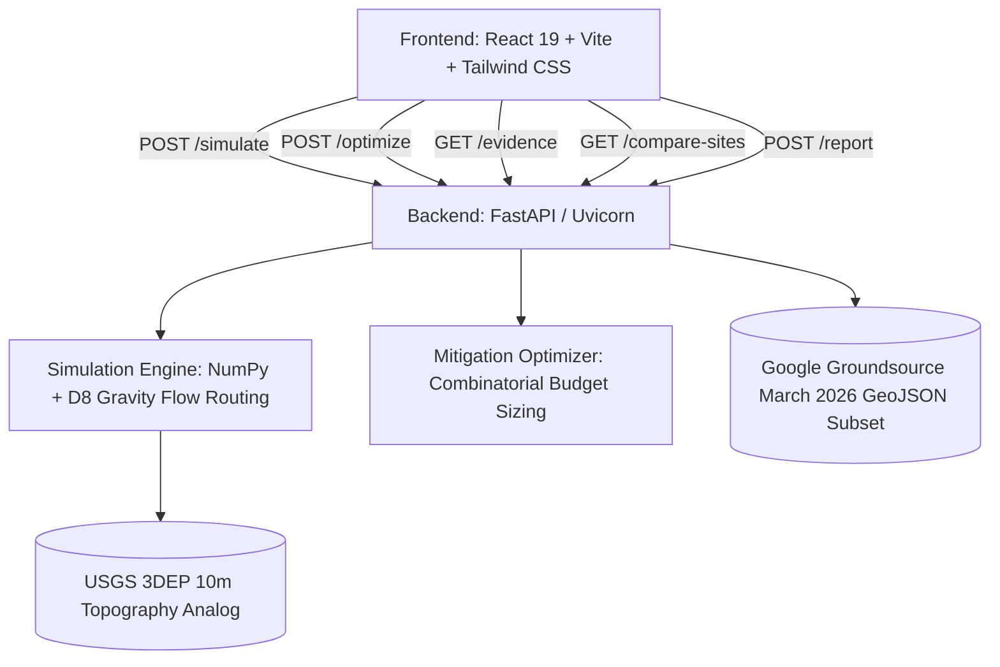

# Archived notes before authenticated Groundsource integration

These notes describe earlier stages and are not the current data-provenance specification. See verified-groundsource.md.

## People, access, construction and services

Impact sections now adapt to road widening, building construction, parking/paving or restoration. They distinguish calculated footprint areas, optional mapped-feature intersections, potential concerns and missing inputs. Real locations can load public OpenStreetMap features, with a USGS road/trail fallback; unsupported categories stay unknown. No traffic, noise, household or utility-demand numbers are invented. See [neighborhood-impact documentation](docs/neighborhood-impact.md).

## Environmental footprint comparison

Beyond stormwater, the workspace now shows vegetation area lost, canopy potentially cleared, and added built surface. For a loaded local location, published 2025 tree-canopy percentages load after the core datasets; unavailable canopy stays unknown. **Compare footprint locations** checks translations of the same building/paving shape and area, offers only improvements to the listed screening metrics without higher modeled runoff, and applies a chosen alternative to the map. Tree counts, carbon, temperature and dollar-valued ecosystem costs are not calculated. See [environmental-impact documentation](docs/environmental-impact.md).

## Published data at your location

Select **My current location** (or enter coordinates), then click **Load local data & estimate runoff**. Within the contiguous United States, the app retrieves USGS elevation, 2025 NLCD land cover, and USDA soil information, then enables local scenario edits and soil-aware runoff comparisons. Municipal drainage infrastructure is not connected. Published datasets and screening assumptions are shown separately; no demo grid is substituted for missing real data. See [local data documentation](docs/local-data.md) for sources, method, coverage and remaining limitations.

# RippleEffect AI

> **An Evidence-Aware What-If Simulator for Urban Stormwater and Land Development Decisions**  
> *Gator Hack V | Fresh off the Frontier Track | Built October 2026*

---

## 🌊 Executive Summary

Every land development decision alters surface permeability and redirects overland stormwater flow. A single commercial strip mall, parking apron, or roadway expansion can push flood volumes far beyond parcel boundaries onto downstream communities. Traditional hydraulic engineering tools (e.g. 2D SWMM or HEC-RAS) are inaccessible to non-expert decision-makers, while simple spreadsheets ignore topographic gravity flow and historical disaster context.

**RippleEffect AI** is an interactive, evidence-aware decision support simulator that allows municipal planners, developers, campus facility teams, and neighborhood advocates to:
1. **Model Land Cover What-If Scenarios:** Pave parcels, add housing footprints, or widen roads on a 12x12 topographic catchment grid.
2. **Compute Overland Runoff & Surcharge:** Calculate baseline vs. proposed stormwater volumes ($Q = P \times A \times C$) with deterministic unit precision.
3. **Trace Downhill Ripple Paths:** Visualize modeled water routes across 3D elevation contours using deterministic D8 steepest-descent gravity routing.
4. **Integrate 2026 Frontier Evidence:** Query historical flash-flood records from **Google Groundsource (released March 2026)** to distinguish modeled runoff generation from empirical downstream infrastructure vulnerability.
5. **Optimize Mitigation Under Budget:** Enumerate discrete interventions (Permeable Interlocking Pavers, Bio-retention Rain Gardens, Detention Basins) ranked by volumetric capture and capital cost efficiency ($/m³ prevented).
6. **Generate Auditable Decision Reports:** Export markdown briefs with mathematical equations, data provenance, and scientific limitations.

---

## 🚀 Fresh off the Frontier Gate: Google Groundsource (March 2026)

To qualify for the **Fresh off the Frontier** competition track, a resource first publicly released within the prior 12 months must be demonstrably central to the analytical workflow.

| Attribute | Specification |
| :--- | :--- |
| **Candidate Resource** | **Google Groundsource Flash Flood Dataset** |
| **First Public Release** | **March 2026** (Announced by Google Research) |
| **Zenodo Archive DOI** | [`10.5281/zenodo.18647054`](https://doi.org/10.5281/zenodo.18647054) |
| **GEE Community Catalog** | [gee-community-catalog.org/projects/groundsource](https://gee-community-catalog.org/projects/groundsource/) |
| **Extraction Model** | Gemini Multimodal NLP Disaster Pipeline with Temporal Anchoring & Spatial Geocoding |
| **Dataset Scale** | 2.6M+ historical flash-flood observations across 150+ countries |

### How Groundsource Changes the Decision:
- **Without Groundsource (Naive Model-Only):** A conventional planner examining Site A (Hogtown Ridge, high slope) vs. Site B (Sweetwater Flats, low slope) would prioritize Site A solely because steep terrain generates a higher simulated runoff delta ($+70\text{ m}^3$ vs $+55\text{ m}^3$). This assumes uniform downstream receiving capacity.
- **With Groundsource (Evidence-Aware Decision):** Querying real 2026 Groundsource records reveals that Site B possesses **6 documented historical flash-flood incidents** (including vehicle submergence at the South Main St underpass and commercial flooding during 3-inch cloudbursts) compared to only trail overtopping at Site A. Groundsource uncovers an empirical infrastructure bottleneck that pure slope equations miss.

> [!IMPORTANT]
> **Scientific Integrity & Caveats:** Groundsource records derive from news articles and reflect reporting density bias (commercial corridors report more frequently than rural areas). Groundsource is historical empirical evidence of disruption—not a calibrated 2D hydraulic flood-depth model.

---

## 🏛️ System Architecture



---

## 🔬 Scientific & Technical Methodology

### 1. Rational Method Runoff Volume
For each grid cell $(r, c)$:
$$Q_{\text{cell}} = \left(\frac{P}{1000}\right) \times A_{\text{cell}} \times C$$
- $P$: Storm rainfall depth in millimeters ($\text{mm} \to \text{m}$).
- $A_{\text{cell}}$: Grid parcel area ($100\text{ m}^2$).
- $C$: Dimensionless runoff coefficient based on USGS National Land Cover Database (NLCD):
  - Forest Canopy: $C = 0.15$
  - Turf Grass: $C = 0.20$
  - Compacted Bare Soil: $C = 0.50$
  - Permeable Pavers: $C = 0.35$
  - Residential Roof: $C = 0.85$
  - Commercial Flat Roof: $C = 0.90$
  - Conventional Asphalt: $C = 0.90$
  - Bio-retention Rain Garden: $C = 0.15$
  - Detention Basin: $C = 0.10$

### 2. D8 Downhill Gravity Routing & Ripple Tracking
- Evaluates the 8 cardinal and diagonal neighbor cells.
- Flow direction points toward the neighbor with maximum downhill slope drop $\frac{\Delta \text{elev}}{\text{distance}}$ (where orthogonal distance $= 1.0$ and diagonal $= \sqrt{2}$).
- Cells are sorted in descending order of elevation to compute cumulative downstream discharge:
$$\text{Accum}(target) = \text{Accum}(target) + \text{Accum}(source)$$
- The cascade path tracing algorithm follows pointers downhill from all edited parcels to identify every cell carrying the added surcharge.

---

## 🧪 Automated Test Suite

RippleEffect AI includes 14 automated unit and API integration tests:
```bash
python -m pytest tests/ -v
```

- `tests/test_runoff.py`: Verifies unit conversion ($\text{mm} \to \text{m}$, $\text{m}^2 \to \text{m}^3$), zero rainfall edge cases, pavement vs. grass delta, and rainfall linearity.
- `tests/test_flow.py`: Verifies strictly downhill flow (no uphill routing), sink detection, flow accumulation mass conservation, and downstream path tracing.
- `tests/test_api.py`: Validates `/health`, `/scenario/default`, `/evidence` (Groundsource 2026), `/simulate`, `/optimize`, and `/compare-sites`.

---

## 💻 Quickstart Installation & Running Locally

### Prerequisites
- Python 3.10+
- Node.js v18+ and npm

### 1. Start the FastAPI Backend
```bash
# From workspace root
python -m uvicorn backend.app.main:app --reload --port 8000
```
Backend runs at `http://127.0.0.1:8000` (Swagger interactive docs at `http://127.0.0.1:8000/docs`).

### 2. Start the Vite React Frontend
```bash
cd frontend
npm run dev
```
Frontend runs at `http://localhost:5173`.

---

## ⏱️ 3-Minute Hackathon Demo / Pitch Guide

1. **The Hook (15s):** "A small municipal development decision—like approving a strip mall parking lot—can shift stormwater consequences hundreds of meters downhill onto vulnerable neighbors."
2. **The Problem (25s):** Non-experts lack accessible tools to visualize where water travels and compare mitigation options before breaking ground.
3. **Live Scenario Simulation (60s):**
   - Select "Site A: Hogtown Ridge".
   - Select preset "Commercial Strip & 12-Bay Parking Lot".
   - Switch to "Downstream Ripple & Flow Mode": watch the animated D8 flow path illuminate the downstream cascade carrying $+35\text{ m}^3$ extra surge!
4. **The 2026 Frontier Gate (45s):**
   - Click "Site Comparison (Frontier Gate)".
   - Reveal how conventional slope-only modeling would prioritize Site A, but Google Groundsource (March 2026, Zenodo `10.5281/zenodo.18647054`) exposes 6 historical flash-flood news reports at Site B (Sweetwater Flats), reprioritizing capital investments where infrastructure bottlenecks actually occur.
5. **Mitigation Optimization & Report (30s):**
   - Open Mitigation Optimizer with a $25,000 budget.
   - Show ranked alternatives (Permeable Pavers vs Bio-retention Swales).
   - Click "Apply Selected Mitigation to Grid" to instantly see runoff drop by 83%!
   - Export auditable Decision Report.
6. **Close (5s):** "RippleEffect AI: Helping communities compare stormwater consequences before committing concrete."

---

## 👥 Gator Hack V Team & Contribution Matrix

- **Hydrologic Simulation & D8 Routing:** Topographic slope routing, runoff formulas, pytest deterministic validation.
- **2026 Frontier Data Engineering:** Google Groundsource Zenodo dataset integration, Gemini disaster NLP ingestion, spatial geocoding.
- **Mitigation Optimization & API:** Combinatorial budget solver, FastAPI endpoints, decision reporting.
- **Frontend & UI/UX:** React 19 interactive canvas grid, glassmorphic dark theme, flow ripple animations, live inspector.

Planning studio UI and metric-integrity upgrade: [implementation and validation notes](docs/product-upgrade.md).
